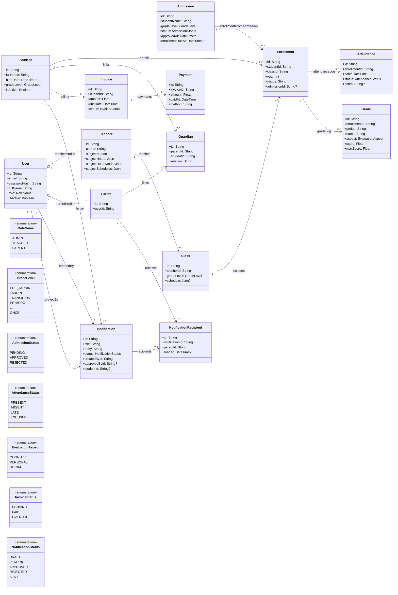

# Diagrama de Clases y Relaciones de Datos

Versión mejorada para lectura rápida: separa dominios funcionales, conserva cardinalidades y agrega enums relevantes.

## Flujo principal de integración

1. `Admission` aprobada -> crea/reutiliza `Student` y genera `Enrollment`.
2. `Enrollment` conecta al estudiante con `Class` (grado + docente).
3. Desde `Enrollment` se registra `Attendance` y `Grade`.
4. `Invoice` y `Payment` dependen de `Student`.
5. `Notification` la crea/aprueba `User` y se entrega a `Parent` por `NotificationRecipient`.

## Reglas clave de consistencia

- `Enrollment`: unicidad por `studentId + classId + year`.
- `Enrollment.admissionId`: unicidad (una admisión no se matricula dos veces).
- `Guardian`: unicidad por `parentId + studentId`.
- `NotificationRecipient`: unicidad por `notificationId + parentId`.
